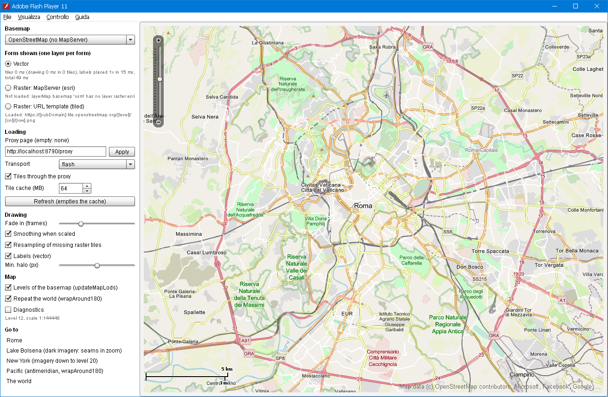

<p align="center"></p>

# arcgis-flex-vectortiles

Tile basemaps, vector and raster, for the `Map` of the ArcGIS API for Flex 3.7.

> Independent project, not affiliated with or endorsed by Esri. ArcGIS is a trademark of Esri.

The library started as a single layer that draws **vector basemaps** (Mapbox Vector Tiles in PBF with a Mapbox
GL style), built to replace `ArcGISTiledMapServiceLayer` now that Esri's raster basemaps are being phased out.
Version **2.0** turns it into a small family of tile layers that share one engine:

| Class | What it shows |
|---|---|
| `VectorTileLayer` | Vector basemaps: an Esri VectorTileServer, an ArcGIS item with a style (custom styles too), any Mapbox GL style (MapLibre, MapTiler, OpenMapTiles, Mapbox…). Same API as in 1.x. |
| `RasterTileLayer` | Image tiles: an ArcGIS MapServer (`format="esri"`, as `ArcGISTiledMapServiceLayer`) or a URL template (`format="tiled"`, as `WebTiledLayer`). |
| `HybridTileLayer` | Either of the two, chosen by configuration: the same tag becomes vector or raster by changing a property or a central map of basemaps. |
| `AbstractTileLayer` | Their common base (not used directly). |

Every layer can load through a proxy, with a token, and its requests can be made by Flash or by the page that
hosts the SWF (the **javascript transport**, which does not depend on `crossdomain.xml`).

<p align="center"></p>
<p align="center"><sub>The <a href="#example">demo</a> in the standalone Flash Player: Esri's OpenStreetMap vector basemap over Rome, with the panel that drives the layers.</sub></p>

## What is new in 2.0

- **Raster basemaps** drawn by the same engine as the vector ones (`RasterTileLayer`), so that they get the
  javascript transport, the proxy rules, readable pixels and the replacement of missing tiles
  ([resampling](#tiles-on-screen)).
- **The javascript transport**: the requests are made by the page with `fetch`, subject to CORS instead of the
  Flash policy files. With the Esri basemap servers no proxy is needed any more.
- **`HybridTileLayer`** and its **map of basemaps**: a view declares *which* basemap it wants, one central file
  decides *how* it is loaded.
- **A memory cache of the tiles** (`tileCacheSize`): a pan or a zoom back shows them again at once.
- `wrapAround180` for every basemap, and the tile properties of Esri's `TiledMapServiceLayer` honored
  (`fadeInFrameCount`, `smoothing`, `displayLevels`, `minScale`/`maxScale` from the MapServer).

The public API of `VectorTileLayer` is unchanged; what behaves differently is listed in
[Upgrading from 1.x](#upgrading-from-1x).

## Usage

The SWC (`bin/arcgis-flex-vectortiles.swc`, also in the repository Releases) goes on the library path of the
application, which must already link the Flex SDK 4.6 and the ArcGIS 3.7 SWC. The MXML namespace is
`xmlns:falpi="http://falpi.org/ags"` (or `xmlns:falpi="org.falpi.ags.layers.*"`).

### VectorTileLayer

```xml
<esri:Map>
    <!-- before: <esri:ArcGISTiledMapServiceLayer url=".../World_Street_Map/MapServer"/> -->
    <falpi:VectorTileLayer
        url="https://basemaps.arcgis.com/arcgis/rest/services/World_Basemap_v2/VectorTileServer"
        proxyURL="https://my-server/proxy/proxy.ashx"/>
</esri:Map>
```

The `url` can be an Esri VectorTileServer, an ArcGIS item (`https://www.arcgis.com/sharing/rest/content/items/<id>`)
or a Mapbox GL style (`https://tiles.openfreemap.org/styles/liberty`, `mapbox://styles/...`): the kind is
recognized from the content of the response (`detectedFormat`). From ActionScript:
`new VectorTileLayer(url, proxyURL, token)`, as the Esri layers, or
`VectorTileLayer.fromURL(url, proxyURL = null, proxyTiles = null)`, where `null` leaves a setting to the
[defaults](#defaults).
A complete example: [examples/src/HybridTileDemo.mxml](examples/src/HybridTileDemo.mxml) (see [Example](#example)).

### RasterTileLayer

```xml
<!-- an ArcGIS MapServer: levels, extent, scale range and copyright from its metadata -->
<falpi:RasterTileLayer url="https://services.arcgisonline.com/ArcGIS/rest/services/World_Imagery/MapServer"/>

<!-- a URL template with the standard Web Mercator levels (0-19 by default) -->
<falpi:RasterTileLayer format="tiled" url="{OSM}" subDomains="{['a', 'b', 'c']}" maxLevel="19"/>
```

where `OSM` is a constant `"https://{subDomain}.tile.openstreetmap.org/{level}/{col}/{row}.png"`. In MXML the
braces of a template are read as a binding: pass it through a constant, as above, or write `\{level\}`.

From ActionScript, the constructor takes `(url, proxyURL, token)` as the Esri layers; two factories say which
format is meant:

```actionscript
RasterTileLayer.fromMapServer(url, proxyURL = null, proxyTiles = null)
RasterTileLayer.fromTemplate(template, subDomains = null, proxyURL = null, proxyTiles = null)
```

`null` for `proxyURL` or `proxyTiles` leaves them to the [defaults](#defaults).

### HybridTileLayer

A large Flex application rarely has a single map: every view declares its basemaps, with the class and the URL
written in place. Moving such an application from raster to vector basemaps, or to another provider, means
editing every one of those tags. `HybridTileLayer` separates *which* basemap a view wants from *how* it is
loaded: the tag names the basemap, and a [map of basemaps](#the-map-of-basemaps), loaded once at startup, lists
for each one its equivalent layers in order of preference.

At startup, once:

```actionscript
[Embed(source="/app/config/Basemaps.xml", mimeType="application/octet-stream")]
private var BasemapsFile:Class;

HybridTileLayer.defaults.layerMap = new XML(String(new BasemapsFile()));
AbstractTileLayer.defaults.proxyURL = proxyPage;      // if a proxy is needed
AbstractTileLayer.defaults.transport = "javascript";  // if the requests should be made by the page
```

`AbstractTileLayer.defaults` applies to every tile layer of the application, `HybridTileLayer`,
`RasterTileLayer` and `VectorTileLayer` alike; `RasterTileLayer.defaults` and `VectorTileLayer.defaults` to the
raster or vector basemaps only (see [Defaults](#defaults)).

Embed the file as bytes, as above, not with `<fx:XML source="...">`: that compiles the XML as MXML, where the
braces of the URL templates (`{level}`, `{subDomain}`…) are taken as bindings and fail to compile (escaping
them as `\{level\}` compiles, but the backslashes stay in the URLs).

In the views:

```xml
<falpi:HybridTileLayer layerSelector="topo" visible="{basemap == 0}"/>
<falpi:HybridTileLayer layerSelector="satellite" visible="{basemap == 1}"/>
<falpi:HybridTileLayer layerSelector="topo" layerType="vector" updateMapLods="true"/>
```

With no type requested, a layer takes the first layer of its basemap: moving the whole application to vector
basemaps is moving the `vector` lines to the top of the file. A view can still ask for a type or a format, or
give a `url` directly. There is no silent fallback: a combination that is not in the map is a load error that
says what is missing.

From ActionScript, two factories create the layer from a basemap of the map or from a URL:

```actionscript
HybridTileLayer.fromSelector(selector, layerType = null, layerFormat = null, proxyURL = null, proxyTiles = null)
HybridTileLayer.fromParams(url, layerType = null, layerFormat = null, proxyURL = null, proxyTiles = null)
```

`null` leaves a setting to the defaults: for `layerType` and `layerFormat` those of `HybridTileLayer.defaults`,
then the first layer of the basemap (`fromSelector`) or `vector` and `esri` (`fromParams`).

## The map of basemaps

```xml
<Basemaps>
   <!-- comments are welcome -->
   <Basemap id="topo" description="Topographic">
      <Layer type="raster" format="esri"  url="https://services.arcgisonline.com/ArcGIS/rest/services/World_Topo_Map/MapServer"/>
      <Layer type="raster" format="tiled" url="https://{subDomain}.arcgisonline.com/ArcGIS/rest/services/World_Topo_Map/MapServer/tile/{level}/{row}/{col}"
             subDomains="services,server"/>
      <Layer type="vector"                url="https://www.arcgis.com/sharing/rest/content/items/7dc6cea0b1764a1f9af2e679f642f0f5"/>
   </Basemap>
   <Basemap id="gray" description="Light gray">
      <Layer type="raster" format="esri" url="https://services.arcgisonline.com/ArcGIS/rest/services/Canvas/World_Light_Gray_Base/MapServer"
             maxLevel="16"/>
      <Layer type="vector" url="https://www.arcgis.com/sharing/rest/content/items/291da5eab3a0412593b66d384379f89f"/>
   </Basemap>
   <Basemap id="osm" description="OpenStreetMap">
      <Layer type="raster" format="tiled" url="https://{subDomain}.tile.openstreetmap.org/{level}/{col}/{row}.png" subDomains="a,b,c"/>
      <!-- this server publishes a crossdomain.xml: Flash can read its tiles without the proxy -->
      <Layer type="vector" url="https://vector.openstreetmap.org/styles/shortbread/colorful.json"
             transport="flash" proxyTiles="false"/>
   </Basemap>
</Basemaps>
```

The same in JSON (one basemap shown):

```json
{
    "osm": {"description": "OpenStreetMap", "layers": [
        {"type": "raster", "format": "tiled", "url": "https://{subDomain}.tile.openstreetmap.org/{level}/{col}/{row}.png", "subDomains": ["a", "b", "c"]},
        {"type": "vector", "url": "https://vector.openstreetmap.org/styles/shortbread/colorful.json", "transport": "flash", "proxyTiles": false}]}
}
```

- Every layer has a `type` (`vector` or `raster`) and a `url`; a raster one has a `format` (`esri` when
  missing).
- Its options are the properties of the same name: `transport` (`flash` or `javascript`), `proxyTiles` and
  `resampling` (`true` or `false`), `subDomains` and `tileServers` (comma separated in XML, arrays in JSON),
  `maxLevel`, `tileCacheSize` (megabytes), `copyright` (used when the service gives none). They are weaker than
  the properties set on the layer and stronger than the defaults (see [the rule](#one-rule-for-every-setting)).
  Other attributes, as `description`, are ignored.
- A layer shows **the first layer of its basemap that matches** `layerType` and, for raster layers,
  `layerFormat`; with neither of them, the first of the list. Several layers of the same type and format are
  alternatives in order of preference: the first is used, and moving a line up is how the choice changes.
- A basemap without a matching layer, a basemap that does not exist, a layer without `url`, an option with an
  invalid value: each is a load error (`loadError`, `fault`) that names the problem, and nothing is replaced by
  something else. An invalid basemap stops only the layers that select it.
- The same map is read once, however many layers use it.

## Transport and proxy

Two independent settings decide how every request of a layer is made:

- **`transport`**, *who* makes it: `"flash"` (default) or `"javascript"`, the page that hosts the SWF.
- **`proxyURL`** and **`proxyTiles`**, *where* it goes: straight to its server, or as `proxyURL?targetURL`.
  Metadata, styles, glyphs and sprites go through the proxy when it is set; tiles too unless
  `proxyTiles="false"`.

| `transport` | Proxy | What it needs |
|---|---|---|
| `flash` | none | A valid `crossdomain.xml` on every server whose data is read (raster images are shown anyway, but not readable) |
| `flash` | set | A proxy on the domain of the SWF (as for the other Esri layers) |
| `javascript` | none | CORS on the servers. The Esri basemap servers and OpenStreetMap send it |
| `javascript` | set | The proxy must answer the page with CORS headers |

With `transport="javascript"` *every* request of the layer goes through the page, never mixed with Flash. The
token (`token`, sent as `tokenParameter`) is appended in every case, but only to the requests sent to the site
of `url`: its registered domain, so that `www.arcgis.com`, `basemaps.arcgis.com` and `myorg.maps.arcgis.com`
are all `arcgis.com`. Fonts, sprites or tiles of a style kept on another site go without it.

**Flash and `crossdomain.xml`.** Flash Player reads data of another domain only if that domain publishes a
`crossdomain.xml`, and only if the policy comes directly from the requested URL: a policy reached through a
redirect to another scheme or host is ignored, and the request fails with `#2048 Security sandbox violation`.
Almost no basemap server publishes one any more, so with the Flash transport the Esri basemaps need the proxy
(for example Esri's [resource-proxy](https://github.com/Esri/resource-proxy), allowing `basemaps.arcgis.com`,
`www.arcgis.com`, `services.arcgisonline.com`, `cdn.arcgis.com` and the hosts of any other style). It must
return binary data unaltered (tiles may arrive gzip-compressed: the layer decompresses them). When tiles are
sent without the proxy to a server without a policy, the layer dispatches a `fault` event that says so.

**The javascript transport.** The layer installs a short script in the page through `ExternalInterface` (the
page needs nothing else, but the SWF must be allowed to script it: `allowScriptAccess` `sameDomain` or
`always`). For every request the page calls `fetch` and passes the answer back as base64 text, which the layer
decodes. The browser rules apply: CORS, cookies, its cache, and in Electron the interception of the requests of
the page. If `ExternalInterface` is not available the layer does not load (`loadError`): it never falls back to
Flash. In our measurements in Electron 11 with Pepper Flash, the vector Esri basemaps loaded through the page
were faster than through a local proxy (about 40 ms per tile instead of about 160 ms, once the connections are
open); decoding base64 costs about 30-40 ms per MB.

**Ruffle.** Ruffle ignores `crossdomain.xml` and makes its requests with `fetch`, so under Ruffle the Flash
transport already behaves like the javascript one: CORS is all that matters.

## Tiles on screen

What the layers do with their tiles, whatever the basemap:

- **Placeholders and fade.** While the tiles of a new view load, the previous ones stay below, scaled, until the
  new ones have faded in (`fadeInFrameCount`, 4 frames by default, as the Esri tiled layers). `updateEnd` is
  dispatched when the fades have ended and, for vector basemaps, the labels are placed.
- **Zoom animations.** The tiles are scaled with the map, smoothed (`smoothing`), and overlap by one pixel of the
  screen so that no light line shows between them.
- **Cache** (`tileCacheSize`, 64 MB by default). The tiles that leave the view are kept, drawn, and shown again
  at once when the view comes back to them (a pan back, a zoom back to a level): no request, no decoding, no
  drawing, no fade. The least recently seen are dropped first; a raster tile of 256 px takes 256 KB, a vector
  tile of 512 px 1 MB. The cache does not depend on the transport or on the cache of the browser. It is emptied
  by `refresh`, by a new `url` or basemap, when the layer is hidden and when it is removed from the map.
- **Hidden layers.** A layer hidden with `visible="false"` gives back the memory of its cache but keeps the
  tiles of the view: a basemap shown again at the same view appears at once, also when the application gave the
  map the levels of another basemap in the meantime (`map.lods`).
- **Resampling** (`resampling`, on by default, as in the ArcGIS Maps SDK for JavaScript). Many services declare
  more levels than they have tiles for: World_Imagery declares 23 but in most of Italy stops at 19, the
  Light/Dark Gray Canvas stop at 16. A raster tile that does not exist shows the enlarged part of the nearest
  tile of a lower level (up to 8 levels above), never "Map data not yet available". A MapServer with the
  `Tilemap` capability (the ArcGIS Online basemaps have it) says which tiles exist, asked in blocks of 32×32
  tiles together with the tiles, so no time is lost; with every format a tile that fails is replaced the same
  way. Where the service has deeper tiles (New York has level 20), they are shown.
- **Failed raster tiles.** An image that does not exist (400, 404, 410, or an answer that is not an image) is
  asked once; one that failed for a temporary reason is not asked again for 30 seconds, and is not kept in the
  cache, so that it is asked again when the view comes back to it.
- **Missing and failed vector tiles.** A sparse vector cache (Esri `indexedVector`) shows the nearest ancestor
  where a tile does not exist. A tile that does not exist (404, empty answer) is asked once; one that failed for
  a temporary reason (a server or network error) is asked again after 30 seconds, and drawn again in its place
  if it is still in view.
- **Beyond the last level** (`maxLevel`), the last level is enlarged.

## Properties

### Common (`AbstractTileLayer`)

| Property | Description |
|---|---|
| `url` | The basemap (see each class). Changing it after the layer has loaded loads the basemap again. |
| `proxyURL` | Proxy page: requests are sent as `proxyURL?URL`. |
| `token` | ArcGIS token or API key, appended to the requests sent to the site of `url` (see [Transport and proxy](#transport-and-proxy)). |
| `tokenParameter` | Name of the token parameter: `token` (default), `access_token` (Mapbox), `key` (MapTiler). |
| `proxyTiles` | Whether the tiles go through the proxy too (default `true`, as the Esri layers). |
| `transport` | `flash` (default) or `javascript`: who makes the requests. |
| `updateMapLods` | While the layer is loaded and visible, the Map takes its levels of detail: the zoom reaches the last level of this basemap and no further (a map past it is brought back first). For the basemaps of a map shown one at a time. |
| `tileCacheSize` | Megabytes of memory for the drawn tiles that left the view (default 64); 0: no cache. See [Tiles on screen](#tiles-on-screen). |
| `maxConnections` | Parallel requests (default 6). |
| `diagnostics` | Shows a box at the top left of the map with the player version, the real frame rate, the tiles being loaded, the cache and where the time of the last update went. Meant for reporting performance problems. |
| `updateTimings` | The timings of the last completed update as text, read-only. |

#### Defaults

What an application wants for all its tile layers is set once, at startup, before the layers are created, in
three objects:

| Object | Applies to | Settings |
|---|---|---|
| `AbstractTileLayer.defaults` | every tile layer | `proxyURL`, `token`, `transport`, `proxyTiles`, `tileCacheSize`, `updateMapLods` |
| `RasterTileLayer.defaults` | raster basemaps | the ones above, and `resampling` |
| `VectorTileLayer.defaults` | vector basemaps | the ones above, and `tilingScheme`, `labelsVisible`, `minimumHaloWidth`, `minimumHaloColor`, `minimumHaloAlpha` |
| `HybridTileLayer.defaults` | `HybridTileLayer` | `layerMap`, `layerType`, `layerFormat`: not settings of the tile layer but the criteria that choose the basemap |

```actionscript
AbstractTileLayer.defaults.proxyURL = proxyPage;     // every tile layer
RasterTileLayer.defaults.transport = "flash";        // the raster basemaps by Flash
VectorTileLayer.defaults.transport = "javascript";   // the vector basemaps by the page
```

`AbstractTileLayer.defaults` starts with the defaults of the library (`transport` `flash`, no proxy or token,
`proxyTiles` `true`, `tileCacheSize` 64, `updateMapLods` `false`). The objects of a kind start with the shared
settings not set, so that they come from `AbstractTileLayer.defaults`, and with the defaults of the library for
their own (`resampling` `true`, `tilingScheme` `arcgis`, `labelsVisible` `true`, halo 1.5 px at 0.8). Reading a
setting of an object gives the value a layer of that kind uses; `isSet(name)` tells whether the object has its
own; setting `null` (`NaN` for numbers) or `clear()` brings it back to how it started. An empty string for
`proxyURL` or `token` in the object of a kind means "none" for that kind.

#### One rule for every setting

These settings follow one rule, from the strongest:

1. the property set on the layer (an attribute of the MXML tag, or assigned by code);
2. for `HybridTileLayer`, the option of the layer chosen from the map of basemaps (`transport`, `proxyTiles`,
   `resampling`, `tileCacheSize`; the map also gives `subDomains`, `tileServers`, `maxLevel` and `copyright`);
3. `RasterTileLayer.defaults` or `VectorTileLayer.defaults`, by the kind of basemap shown (for a
   `HybridTileLayer`, the one of the basemap in use);
4. `AbstractTileLayer.defaults`.

Reading these properties gives the value in use. For `proxyURL`, `token` and `transport` of a layer, `null`
means "not set" and an empty string for `proxyURL` and `token` means "none". A layer already loaded is not
loaded again when a default changes.

Inherited from Esri's `TiledMapServiceLayer`, with the same meaning and defaults:

| Property | Description |
|---|---|
| `fadeInFrameCount` | Frames over which a new tile fades in (default 4): its opacity starts at 1/n and grows by 1/n each frame. 1 or 0: no fade. |
| `smoothing` | Bilinear smoothing of the tiles when they are scaled: placeholders, levels beyond the last one, zoom animations (default `true`). At their own size nothing changes. Not applicable to images of another domain loaded by Flash without proxy, whose pixels Flash does not give to the layer. |
| `displayLevels` | The levels (`LOD.level` of the basemap) at which the layer shows its tiles; `null` (default) for all. Esri shows a tiled layer only when the scale of the map is exactly the one of a level; this engine draws at any scale, so the level nearest to the scale of the map counts. |

Inherited from `Layer`: `minScale` and `maxScale` (0: no limit) hide the layer out of a range of scales. With
`format="esri"` they are taken from the metadata of the MapServer, as `ArcGISTiledMapServiceLayer` does, unless
the application sets them: set one to 0 to ignore the limit of the service. When the basemap changes (`url`,
`format`, a different basemap of `HybridTileLayer`) the range of the previous one is dropped.

Also inherited: `tileInfo`, `fullExtent`, `initialExtent`, `spatialReference`, `copyright` (taken from the
basemap, unless the application sets one), `visible`, `alpha`…

### VectorTileLayer

| Property | Description |
|---|---|
| `style` | Mapbox GL style (Object or JSON string) that replaces the one published at the URL. |
| `tilingScheme` | `arcgis` (default): the `Map` gets the 24 levels of the classic raster basemaps, so `map.level` and the scales stay the same as before. `service`: levels of the vector service (512 px tiles, one level fewer at the same scale). |
| `labelsVisible` | Shows or hides labels and icons. |
| `minimumHaloWidth` | Halo width in pixels given to the labels whose style has none, to keep them readable on busy backgrounds (default 1.5). 0 draws them as the style says. |
| `minimumHaloColor` | Color of that halo as `0xRRGGBB`. Not set (the default): white behind dark text, black behind light text. |
| `minimumHaloAlpha` | Opacity of that halo, 0 to 1 (default 0.8). |
| `styleDefinition` | The parsed style, read-only. |
| `detectedFormat` | What the `url` was recognized as, read-only: `arcgis` (an item of an ArcGIS portal or a VectorTileServer) or `maplibre` (a MapLibre / Mapbox GL style document, style specification v8); `null` without `url`. |
| `styleOrigin` | Where the style in use comes from, read-only: `item` (the style of the ArcGIS item), `service` (the default style of the VectorTileServer), `document` (the style document at the `url`) or `inline` (the `style` property, given by the application instead of downloaded, which replaces the style at the `url`: the `url`, if any, still gives the service, its grid and extent, and the base of the relative URLs). |

### RasterTileLayer

| Property | Description |
|---|---|
| `format` | `esri` (default): an ArcGIS MapServer, read as `ArcGISTiledMapServiceLayer` does (levels, extent, scale range, copyright, tile servers from its metadata; tiles `url/tile/{level}/{row}/{col}`). `tiled`: a URL template with `{level}`, `{row}`, `{col}`, `{subDomain}`, as `WebTiledLayer`, without metadata. |
| `subDomains` | `tiled`: the values of `{subDomain}`, one per row in turn. |
| `tileServers` | `esri`: the servers of the tiles, one per row in turn. Not set: the ones the service declares, or for ArcGIS Online both `services` and `server.arcgisonline.com`, as Esri does. |
| `maxLevel` | `esri`: the levels of the service beyond it are dropped. `tiled`: the levels are 0 to `maxLevel` (default 19). Beyond it the last level is enlarged. |
| `resampling` | Missing raster tiles shown as the enlarged part of a lower level (default `true`; see [Tiles on screen](#tiles-on-screen)). `false`: the tiles of the service as they are. |

### HybridTileLayer

All the properties above (the vector ones apply when the layer shows a vector basemap, the raster ones when it
shows a raster one), plus:

| Property | Description |
|---|---|
| `layerSelector` | The basemap of `layerMap` to show (ignored when `url` is set). |
| `layerMap` | The map of basemaps: XML (or its text) or JSON (parsed or its text). Not set: `HybridTileLayer.defaults.layerMap`. |
| `layerType` | `vector` or `raster`. Not set: `HybridTileLayer.defaults.layerType`; if that is not set either, the type of the layer chosen from the map (or `vector` with a direct `url`). |
| `layerFormat` | `esri` or `tiled`, for raster layers. Not set: `HybridTileLayer.defaults.layerFormat`; then the format of the layer chosen from the map (or `esri` with a direct `url`). |
| `activeLayerType`, `activeLayerFormat`, `activeURL` | What is in use, read-only. |

Its own defaults, `HybridTileLayer.defaults`, are `layerMap`, `layerType` and `layerFormat`: not settings of the
tile layer but the criteria that choose the layer of the basemap (set on the layer or as defaults, otherwise
the first layer of the basemap). The other settings follow [the rule](#one-rule-for-every-setting), with the
options of the map of basemaps as its second step and the defaults of the kind of basemap in use.

## Events

`load`, `loadError`, `updateStart`, `updateEnd` (once the tiles of the view are drawn and faded in and, for vector
basemaps, the labels are placed), `isInScaleRangeChange`, plus `fault` (`FaultEvent`) when the basemap cannot be
loaded or its tiles cannot be read.

## Example

[examples/src/HybridTileDemo.mxml](examples/src/HybridTileDemo.mxml) is a map with three `HybridTileLayer`s that
show the same basemap of a map of basemaps in its three forms (vector, raster `esri`, raster `tiled`), one
visible at a time as in an application with a basemap selector: switching back to a form shows it at once. A
panel next to the map changes the basemap and the form shown, the proxy page, and the properties of the layers:
transport, `proxyTiles`, `tileCacheSize` and `refresh`, `fadeInFrameCount`, `smoothing`, `resampling`, labels
and their halo, `updateMapLods`, `wrapAround180` of the map and `diagnostics`. Under each form it shows what the
layer loaded, the timings of its last update or why it could not load (the imagery has no vector form,
OpenStreetMap no MapServer); a few places show what the layers do (dark imagery for the zoom animations, New
York for deep imagery, the antimeridian).

**Build.** `examples/` is a Flash Builder project, `arcgis-flex-vectortiles-demo`: import it in the workspace
of the library project (*File > Import > General > Existing Projects into Workspace*), which it references.
It links the SWC of the library and `libs/agslib-3.7-2014-11-06.swc` into the SWF, with the Flex framework
(*merged into code*), and produces `examples/bin-debug/HybridTileDemo.swf`, without an HTML page.

**Run.** [tests/](tests) holds a development server for it, and nothing else: a Node.js script
(`tests/server.cmd`, Node.js required) that hosts the SWF and a proxy page on the same origin,
`http://localhost:8790`, and opens the SWF in the standalone Flash Player:

```
tests\server.cmd [<file.swf>] [--flashbuilder <folder>] [--player <FlashPlayer.exe>] [--no-player] [--keep]
```

- With no SWF it builds the demo first, from the sources of the library, into the output folder of its project
  (`examples/bin-debug/HybridTileDemo.swf`): `tests\server.cmd` alone builds and runs it.
- The tools come from Flash Builder: `--flashbuilder` (its installation folder), otherwise the default folders of
  the Windows setups of Flash Builder 4.7 and 4.6 (`%ProgramFiles%\Adobe\Adobe Flash Builder 4.7 (64 Bit)`…).
  From it the Flex SDK 4.6 and its Java build the demo, and the debugger player
  (`player\win\<version>\FlashPlayerDebugger.exe`) runs it; when Flash Builder is not found the script says so.
  `--player` gives another standalone Flash Player, `--no-player` only serves.
- `http://localhost:8790/HybridTileDemo.swf` is the SWF, `http://localhost:8790/proxy` the proxy page (ArcGIS
  convention, `proxy?<url>`), which is the one the demo uses by default. Being on the same origin as the SWF, it
  needs no `crossdomain.xml`. It answers only on `127.0.0.1` and only for the sites of the demo (`arcgis.com`,
  `arcgisonline.com`, `openstreetmap.org`; more with `--allow`): it is meant for development, not as a proxy for
  production.
- The Flex SDK and the Flash Player cannot be redistributed, so they are not in the repository. When the player
  is closed the server stops (`--keep` keeps it running); `--verbose` logs the headers of every request.
- In Flash Builder the project has an *External Tools* configuration, *Run HybridTileDemo (dev server)*
  (*Run > External Tools*), that starts the server with the SWF of the project and the player of Flash Builder;
  its console shows the requests of the proxy, and its Terminate button stops the server and the player.

The standalone player has no page around the SWF, so `ExternalInterface` is not available there and the demo
uses the Flash transport. **To try the javascript transport, use a runtime of your choice** that runs the SWF in
a page with Flash (for example Electron with Pepper Flash): `http://localhost:8790/` is a page that embeds the
SWF, on the same origin as the proxy page.

FlashVars: `proxyURL` (the proxy page at start; an empty value for none) and `transport` (`flash` or
`javascript`; by default `javascript` when the page can be scripted, otherwise `flash`).

## Style coverage (vector basemaps)

| Element | Status |
|---|---|
| `background`, `fill`, `line`, `circle` | Supported: colors, opacity, `fill-pattern`, `line-dasharray`, `line-offset`, `line-blur`, cap/join, `*-translate` |
| `line-pattern` | Supported: the image follows the line segment by segment, with the joins filled |
| `symbol` | Labels (SDF glyphs with halo), text along lines, line wrapping, anchors, offsets, `text-transform`, sprite icons (SDF icons in `icon-color`), rotation, collisions with priority by style order and `symbol-sort-key` |
| Sprites | A single sheet or several (`sprite` as an array of `{id, url}`, images named `id:name`) |
| Filters | Legacy syntax and expressions |
| Functions | Legacy `stops` (zoom, property, zoom+property) and expressions (`match`, `case`, `interpolate`, `step`, `coalesce`, `let`/`var`, math, strings, colors…) |
| `fill-extrusion` | Drawn flat (footprint) |
| `line-gap-width` | Approximated with a single line |
| `raster`, `hillshade`, `heatmap`, terrain, sky | Ignored (raster basemaps are a `RasterTileLayer`) |
| `icon-text-fit`, `text-variable-anchor` | Not implemented (not used by the Esri, OpenFreeMap and VersaTiles styles) |
| Complex scripts (Arabic, Indic, bidi) | Not supported (Latin, Greek, Cyrillic, CJK are) |

## Design

### One engine, composed content

Vector and raster basemaps need the same machinery: follow the extent of the Map, decide which tiles cover the
view, keep the old ones as placeholders while the new ones load, scale everything during the zoom animation,
spread the work over the frames so that panning stays smooth, report `updateStart`/`updateEnd`, load through a
proxy. Version 1.x had all of this inside `VectorTileLayer`; 2.0 moves it to `AbstractTileLayer` and leaves to a
**content** (`VectorContent`, `RasterContent`) only what really differs: how the basemap is described, how a
tile is loaded and drawn, and the overlays (the labels of the vector basemaps).

The variability is *composed*, not inherited. A layer holds one content and delegates to it; `HybridTileLayer`
holds both and switches between them. The contents are plain objects, not layers: the Esri `Map` works only with
the layers in `map.layers` (it gives them the map, asks them for their levels, sends them extent, zoom and pan
events through internal API), so a layer nested inside another one would never be driven by the map. With the
content as a separate object there is a single real layer, and the code of each kind of basemap stays in one
place.

### Why the raster tiles are drawn by the library

Flash reads **data** from another domain (JSON, PBF, the bytes of an image) only if that server publishes a
`crossdomain.xml` that allows it. Flash *shows* images of another domain without a policy, but cannot read
their pixels. That is why in Flash every vector basemap needed a proxy, and why raster basemaps worked without
one only as long as the layer did not need their metadata or their pixels.

The javascript transport solves this at the root: the page makes the request, the browser applies **CORS**, and
the Esri servers answer `Access-Control-Allow-Origin: *`. But bytes that reach Flash through `ExternalInterface`
can only be shown if the layer draws the tile itself: the image engine of Esri's `TiledMapServiceLayer` can only
load a URL. Drawing the raster tiles with the engine of the library is what makes the transport, the proxy
rules, the cache and the resampling the same for every basemap. It also gives **readable pixels**: tiles
decoded from bytes of the page can be read, so `BitmapData.draw` of the map (client side snapshots, printing)
works, where Esri's raster layers raise a `SecurityError` on images of other domains. Raster and vector tiles
are aligned by the same rule (the position rounded to the pixel; the Esri image engine truncates it, so the two
could differ by one pixel).

## Changes in 2.1.0

- **Factories**: `VectorTileLayer.fromURL`, `RasterTileLayer.fromMapServer` and `fromTemplate`,
  `HybridTileLayer.fromSelector` and `fromParams`, to create a layer by code with the settings that the
  constructor of the Esri layers does not have (format, sub-domains, selector, type), and `proxyURL` and
  `proxyTiles` at the end.
- **`detectedFormat` and `styleOrigin`** on the vector layers tell what their `url` was recognized as (`arcgis`
  or `maplibre`) and where the style in use comes from (`item`, `service`, `document` or `inline`); both `null`
  until loaded, and for a `HybridTileLayer` that shows a raster basemap.
- **Defaults for every tile layer, and per kind of basemap** ([Defaults](#defaults)):
  `AbstractTileLayer.defaults`, `RasterTileLayer.defaults`, `VectorTileLayer.defaults` and
  `HybridTileLayer.defaults` replace the static defaults of `HybridTileLayer`. They apply to `RasterTileLayer`
  and `VectorTileLayer` too, and the raster and vector basemaps can have different ones (for example the raster
  ones by Flash, the vector ones by the page). The vector settings (`tilingScheme`, `labelsVisible`, minimum
  halo) have defaults too.
- **Not compatible with 2.0.0**: the static defaults of `HybridTileLayer` are removed. In place of
  `HybridTileLayer.defaultTransport = "javascript"` write `AbstractTileLayer.defaults.transport = "javascript"`,
  and likewise for `defaultProxyURL`, `defaultToken`, `defaultProxyTiles`, `defaultUpdateMapLods` and
  `defaultTileCacheSize`; `RasterTileLayer.defaults.resampling` for `defaultResampling`;
  `HybridTileLayer.defaults.layerMap`, `layerType` and `layerFormat` for `defaultLayerMap`, `defaultLayerType`
  and `defaultLayerFormat`.
- `proxyURL`, `token` and `transport` of every tile layer: `null` means "not set" (the defaults), an empty
  string "none".

## Upgrading from 1.x

- `VectorTileLayer` keeps its properties, events and behavior: the vector tiles and labels are drawn exactly as
  in 1.x (checked pixel by pixel on a set of styles, levels and pan/zoom sequences). New on it: `proxyTiles`,
  `transport`, `updateMapLods`, `tileCacheSize`.
- New tiles fade in over 4 frames (`fadeInFrameCount="1"` for the 1.x behavior) and are smoothed whenever they
  are scaled (`smoothing`); at rest the map is drawn exactly as before. `displayLevels` is honored.
- The tiles that leave the view are kept in memory (64 MB by default); in 1.x only the data of the last 96 tiles
  was kept, and they were drawn again. `tileCacheSize="0"` for the 1.x behavior.
- A basemap shown again keeps the tiles it had also when the application changed `map.lods` meanwhile; in 1.x
  the base class of Esri dropped them in that case, and the view was loaded again from a white background.
- The token is sent only to the site of `url`; in 1.x it went with every request, also to other hosts.
- `maxConnections` applies when it changes; in 1.x it was read only when the basemap loaded.
- A vector tile that failed for a temporary reason is asked again after 30 seconds; in 1.x it was taken as
  missing until `refresh`.
- When the `url` of a layer changes, the copyright taken from the previous basemap is replaced by the new one
  (in 1.x it stayed); a copyright set by the application is kept.
- Between labels of the same priority the choice no longer depends on the order in which the tiles arrived:
  the same view shows the same labels in every session.
- With `wrapAround180` on the `Map`, vector basemaps repeat the world across the antimeridian (in 1.x they
  stopped at ±180°).
- At level 0 of the `arcgis` tiling scheme (the vector zoom -1) vector basemaps were blank: a style layer
  without `minzoom` was hidden below zoom 0. As in MapLibre, only a positive `minzoom` hides a layer now.
- During the zoom animations thin light lines could show between the tiles for an instant; the tiles now
  overlap by one pixel of the screen while the map is scaled.
- Raster basemaps declared with the Esri classes keep working; replacing them with `RasterTileLayer` or
  `HybridTileLayer` is what gives them the transport, `proxyTiles`, resampling, the cache, `maxLevel` and
  `updateMapLods`.

## Known limitations and untested areas

- **Projection**: only Web Mercator (102100/3857) has been tested. The code for services in other projections
  (levels taken from the service `tileInfo`) has not been tested.
- **`wrapAround180`**: the world is repeated across the antimeridian for grids of Web Mercator or geographic
  coordinates that start at -180° (the Esri, OpenStreetMap and Mapbox GL basemaps); other grids are shown once.
  Every copy of a tile is drawn on its own, and the labels of a vector basemap are placed in every copy of the
  world in view.
- **Map rotation** (`mapRotation`) has not been tested.
- Raster tiles of another domain loaded by Flash without proxy (Flash transport, `proxyTiles="false"`) cannot
  be read: no snapshots of the map and no `smoothing`, also for the resampled ones, which are cut with a
  `scrollRect` instead of copied (a rule of Flash, the same as for the Esri raster layers). Through the proxy
  or with the javascript transport they can.
- **Resampling** keeps all the levels of the service on the map: where its tiles end, the deeper levels show the
  last ones enlarged, more and more blurred (16 times at level 23 over imagery that ends at 19). Replacing tiles
  that fail costs the time the server takes to answer the error: OpenStreetMap needs more than a second for each
  of its 400 answers (the `tiled` format asks only the levels up to `maxLevel`, 19 by default).
- With the Flash transport inside a browser plugin the HTTP status of a failed request is often not given to
  Flash: a tile that does not exist is then taken as a temporary failure and asked again after 30 seconds (a
  vector one while in view, a raster one when the view comes back to it). The javascript transport and AIR give the status.
- Labels are placed during a drag, with the button still held: every 0.15 s while the map moves (less often
  when placing them is slow: at most an eighth of the time) and when it stays still for a moment. These
  placements only add the labels of the area brought into view; on release all of them are placed again, so a
  few may move.
- During a zoom animation the labels keep their size and follow the map; when zooming out, those that would
  overlap a more important one are hidden. They are placed again at the new scale when the animation ends.
- CPU rendering of the vector tiles, spread over several frames: a few milliseconds per tile with the Esri styles
  in a release build, more with styles that have hundreds of layers (e.g. OpenStreetMap Shortbread).
- **Measure performance on release builds**: with a debug SWF or the debugger Flash Player the same code runs
  many times slower (about 30 times in our measurements).
- Esri **Basemap Styles service v2** (`basemapstyles-api.arcgis.com`, with API key) has not been tested;
  tested: the `World_Basemap_v2` VectorTileServer, Esri's public items (Street, Navigation, Street Night,
  Topographic, OpenStreetMap, Light/Dark Gray Canvas with their reference layers), OpenStreetMap Shortbread
  (VersaTiles styles) and OpenFreeMap; raster: the World_* MapServers of ArcGIS Online and the OpenStreetMap tiles.
- Tested players: Flash Player 32 (Pepper Flash in Electron 11, AIR for development) and, for vector basemaps,
  Ruffle.
- Esri's "Canvas" basemaps have their labels in a separate item ("Reference"): add it as a second layer above
  the base.

## Layout

```
src/org/falpi/ags/layers/
  AbstractTileLayer.as           common base: Map integration, tiles, frames, cache, proxy/token/transport
  VectorTileLayer.as             vector basemaps
  RasterTileLayer.as             raster basemaps
  HybridTileLayer.as             either of the two, by configuration; the map of basemaps
src/org/falpi/ags/layers/supportClasses/
  TileContent.as                 what a layer shows (base of the contents)
  TileCache.as                   the drawn tiles that left the view (tileCacheSize)
  LayerDefaults.as               the mechanism of the objects of defaults (initial values, isSet, clear)
  TileLayerDefaults.as           defaults of every tile layer (AbstractTileLayer.defaults); the raster and vector
  RasterTileLayerDefaults.as     ones extend them (RasterTileLayer.defaults, VectorTileLayer.defaults)
  VectorTileLayerDefaults.as
  HybridTileLayerDefaults.as     defaults of HybridTileLayer: layerMap, layerType, layerFormat
  VectorContent.as               vector basemaps: style, PBF data, drawing, labels
  RasterContent.as               raster basemaps: MapServer metadata or template, image tiles, resampling
src/org/falpi/ags/layers/vectorTiles/   the vector engine
  source/                        service / item / style / TileJSON resolution
  style/                         Mapbox GL style: layers, properties, filters, expressions, colors
  mvt/, pbf/                     Protocol Buffers and Mapbox Vector Tile decoders
  render/                        CPU tile renderer and sprites
  labels/                        SDF glyphs, text shaping, collisions, placement
src/org/falpi/ags/net/           loading shared by all the layers: proxy, token, gzip, javascript transport
src/org/falpi/ags/utils/         URLs, Web Mercator grid, JSON of the ArcGIS services
examples/                        the demo: Flash Builder project arcgis-flex-vectortiles-demo
tests/                           development server of the demo: SWF and proxy page on localhost:8790
src/manifest.xml                 MXML namespace http://falpi.org/ags
libs/agslib-3.7-2014-11-06.swc   ArcGIS API for Flex (linked externally)
```

## Build

**Flash Builder 4.7**: *File > Import > General > Existing Projects into Workspace* and select
this folder. It is a Flex library project (SDK 4.6) that produces `bin/arcgis-flex-vectortiles.swc`;
the Flex framework and `libs/agslib-3.7-2014-11-06.swc` are linked externally.
The ArcGIS API for Flex SWC is not in the repository: copy it into `libs/` (see [libs/README.md](libs/README.md)).
The compiled SWC of this extension is available in the repository Releases.

The example is compiled as described in [Example](#example).

## License

Distributed under the [Apache 2.0](LICENSE) license. Copyright 2026 falpi.

The ArcGIS API for Flex, required to compile and use the layer, belongs to Esri and has its own license:
it is neither included in nor covered by this license.
